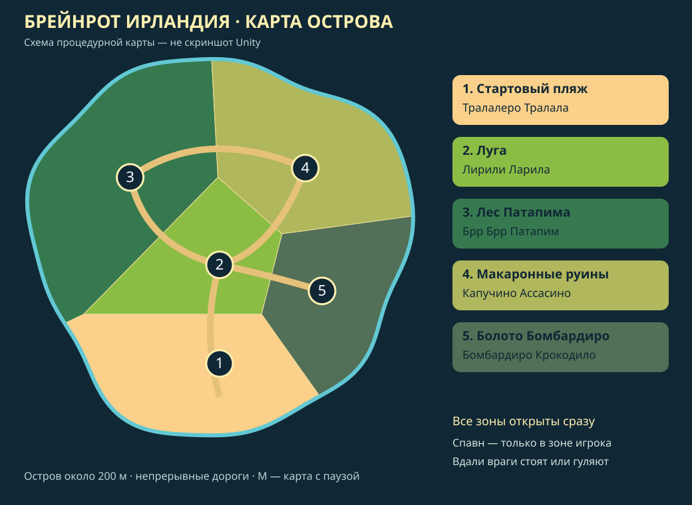

# Брейнрот Ирландия — исследование острова

Unity **6000.3.11f1**, URP **17.3.0**, Windows/Android. Большой процедурный остров с пятью открытыми зонами, локальными врагами, прокачкой и боями с битой.

| Зона | Враг | Поведение |
|---|---|---|
| Стартовый пляж | Тралалеро Тралала | Акула, ближний удар после подготовки |
| Луга | Лирили Ларила | Слон, прямой рывок с предупреждением |
| Лес Патапима | Брр Брр Патапим | Дерево, медленный сильный удар |
| Макаронные руины | Капучино Ассасино | Кофейный ниндзя, короткий быстрый выпад |
| Болото Бомбардиро | Бомбардиро Крокодило | Крокодил, тяжёлый рывок |

Волны и появление боссов отключены. Новые враги появляются случайно только в текущей зоне. Далёкие враги стоят или гуляют. Они замечают игрока поблизости, теряют интерес по дистанции и не преследуют его в другую зону. Существующие враги покинутой зоны могут остаться там в ограниченном количестве — это не новые появления.

## Обновление работающей копии

1. Закройте Unity и сохраните резервную копию своих изменений.
2. Скачайте свежий ZIP ветки `codex/brainrot-ireland`.
3. Скопируйте **Brainrot Ireland/Assets/Brainrot** из архива в **Assets** своего рабочего проекта, объединив папки с заменой файлов. Предварительно удалять старую папку не нужно. Ваши Generated, профиль баланса и Assets/Resources/Upgrades сохранятся.
4. Откройте проект через **START_UNITY_DX11.bat**, дождитесь компиляции.
5. Выполните **Tools → TungTung → Создать или обновить игру** (старый пункт **Build Game** тоже работает).
6. Откройте **Assets/Scenes/BrainrotIreland.unity**, нажмите Play и **ИГРАТЬ**.

Для новой копии выберите в Unity Hub именно вложенную папку с Assets/Packages/ProjectSettings, разместив её по короткому пути `C:\UnityProjects\BrainrotIreland`. Не открывайте внешнюю папку репозитория. Не переносите старую Library. При ошибках графики или распаковки пакетов см. [TROUBLESHOOTING.md](TROUBLESHOOTING.md).

## Управление

WASD — движение, мышь — камера, ЛКМ — удар, Shift — бег, Пробел — рывок по направлению движения, V — фиксация поворота по камере, M — карта с паузой, Esc — закрыть карту/пауза. На Android есть сенсорные кнопки и джойстик. Интерфейс, улучшения, карта и настройки — на русском.

Бита делает видимый широкий взмах с белым затухающим шлейфом. Попадание рассчитывается после начала взмаха, подтверждается отметкой/звуком/подсветкой и сильнее отбрасывает врага. Подготовленные атаки врагов позволяют отойти или уклониться. Пауза отменяет незавершённые взмахи, чтобы после неё не появлялся невидимый урон.

## Настройки и новые персонажи

**Tools → TungTung → Настройки игры** — русское окно баланса; старый пункт Game Settings сохранён. Профиль в `Assets/Brainrot/Generated/Resources/GameBalance.asset`. [Полная инструкция](GAME_SETTINGS.md).

`DefaultCharacter.asset` и `WoodenBat.asset` в том же Resources описывают героя и оружие. По умолчанию характеристики и тайминг берутся из общего профиля; флаги собственных характеристик/тайминга позволяют переопределить их. Новые герои могут иметь независимые наборы статов, оружие и runtime-способности через PlayerAbilityDefinition. Сейчас играбельный герой один — Тун-Тун Сахур; новых героев и выбора персонажа пока нет.

## Проверки и ограничения

**Unity Editor в облаке отсутствует. Эта новая версия не запускалась в Unity и не собиралась в EXE/APK.** Проверка исходников и интеграции выполнена; PlayMode-тесты подготовлены для запуска на ПК владельца. Успешный тест владельца относился к предыдущей версии.

Window → General → Test Runner → PlayMode → Run All. Проверяются границы/зоны, локальный спавн, поведение вдали, обнаружение и потеря интереса, подготовка атак, рывки, задержка контакта биты, отмена при паузе, pooling/подсветка, XP и персонажи.

Статическая проверка: `python -m pip install tree-sitter tree-sitter-c-sharp`, затем `python Tools/validate_source.py`. Команды сборки Windows/Android сохранены в Tools/TungTung; для Android необходим модуль SDK/NDK/OpenJDK.

Карта — игровая процедурная версия по мотивам референса, а не точная копия изображения. Поверхность непрерывная и плоская; ручьи/заводи декоративные, с землёй под ними. Декорации без коллизий для дешёвого прямого AI; дорогам оставлено место. Позже нужны реальные модели/анимации, проверка визуала, баланса и FPS на Windows/Android. Платные/неизвестные ассеты не использованы.
